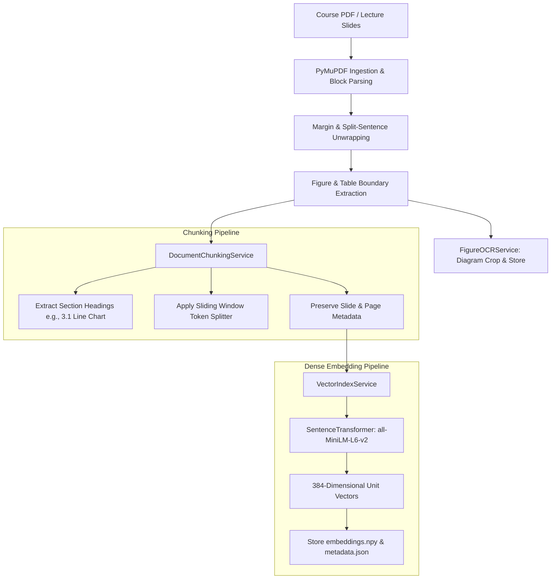
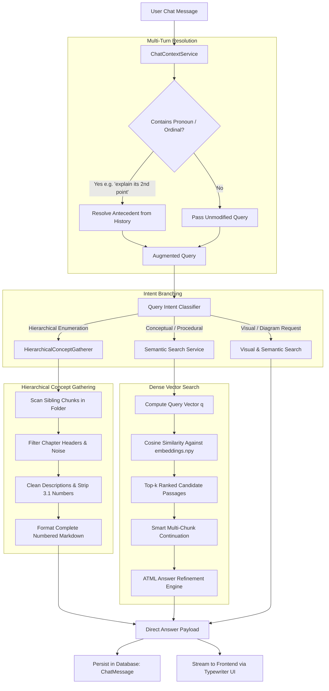
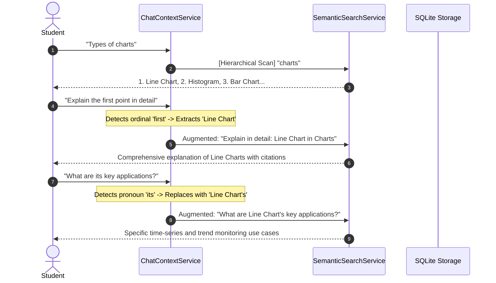
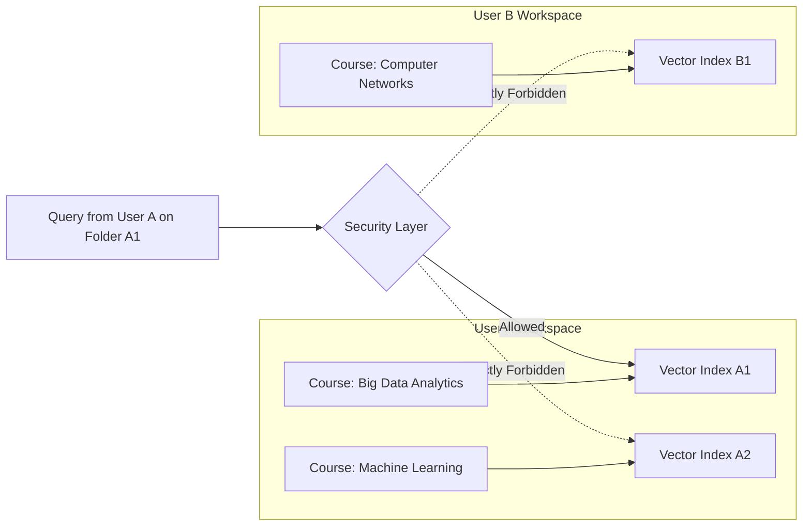

# Nalanda AI — NLP (Natural Language Processing) Subsystem Architecture

## Academic & Engineering Specification

> **Abstract**—The **Nalanda AI NLP Subsystem** is an edge-native, privacy-preserving academic information retrieval and conversational intelligence engine. Designed to run completely offline on local student hardware (Apple Silicon MPS / CPU), it eliminates recurring cloud LLM API costs while enforcing strict multi-tenant isolation across university courses and folders. The subsystem integrates multi-format document ingestion, semantic slide-boundary chunking, 384-dimensional dense vector embeddings ($\text{all-MiniLM-L6-v2}$), multi-turn anaphoric reference resolution, exhaustive hierarchical concept gathering, multimodal diagram/table alignment, and structure-preserving OCR normalization. This document provides a comprehensive architectural breakdown, flowcharts, mathematical formalisms, and comparative tables detailing the subsystem's design and operation.

---

## 1. End-to-End Pipeline Architecture

The NLP subsystem processes course materials through a dual-lifecycle architecture: **Offline Indexing Lifecycle** (document ingestion and embedding) and **Online Query & Conversational Lifecycle** (intent classification, context resolution, and hierarchical synthesis).

```
┌──────────────────────────────────────────────────────────────────────────────────────────────────┐
│                                 NALANDA AI NLP ARCHITECTURE                                      │
└──────────────────────────────────────────────────────────────────────────────────────────────────┘
                                                 │
            ┌────────────────────────────────────┴────────────────────────────────────┐
            ▼                                                                         ▼
┌──────────────────────────────────────────────┐          ┌──────────────────────────────────────────────┐
│        LIFECYCLE 1: INGESTION & INDEX        │          │       LIFECYCLE 2: CONVERSATION & SEARCH     │
│                                              │          │                                              │
│  1. Ingestion: PDF / Slides (PyMuPDF)        │          │  1. User Query (REST / Chat Form)            │
│  2. Layout Unwrapping & Margin Sanitization  │          │  2. ChatContextService: Anaphora Resolution  │
│  3. DocumentChunkingService: Slide Chunks    │          │  3. Intent Classifier (Visual/Concept/Types) │
│  4. FigureOCRService: Diagram Extraction     │          │  4. Hierarchical Concept vs. Dense Vector    │
│  5. VectorIndexService: MiniLM-L6-v2 Embed   │          │  5. TextNormalizer & Multimodal Alignment    │
│  6. Persistent Storage: embeddings.npy       │          │  6. Database Persistence (Conversations)     │
└──────────────────────────────────────────────┘          └──────────────────────────────────────────────┘
```

---

## 2. Ingestion, Layout Processing, and Vector Indexing

### 2.1 Complete Ingestion & Indexing Flowchart



### 2.2 Mathematical Formalization of Dense Indexing

Given a document chunk $c_i \in C$, the local embedding model $\mathcal{M}_{\text{embed}}$ maps the normalized token sequence $T(c_i)$ to a dense representation $\vec{e}_i \in \mathbb{R}^{384}$:

$$\vec{h}_i = \text{MeanPooling}(\mathcal{M}_{\text{embed}}(T(c_i)))$$

$$\vec{e}_i = \frac{\vec{h}_i}{\|\vec{h}_i\|_2}$$

Where $\vec{e}_i$ lies on the 384-dimensional unit hypersphere $\mathbb{S}^{383}$. Vector indexes are stored in strictly isolated directory paths per user and folder:

$$\text{IndexPath}(u, f) = \text{BASE\_STORAGE\_DIR} / \text{"users"} / u / \text{"folders"} / f / \text{"vector\_index"}$$

---

## 3. Online Conversational & Semantic Search Pipeline

### 3.1 Query Resolution & Retrieval Workflow



---

## 4. NLP Module Component Matrix

| Module | Primary Class / Function | Architectural Purpose | Key Algorithms / Models |
| :--- | :--- | :--- | :--- |
| [`chat_context_service.py`](file:///Users/mayanksmac/Desktop/capstone/backend/services/NLP/chat_context_service.py) | `ChatContextService` | Resolves pronouns (*it, this, that*) and ordinals (*second point*) across multi-turn history. | Regex antecedent extraction, bounded chronological history resolution, ordinal mapper. |
| [`hierarchical_concept_gatherer.py`](file:///Users/mayanksmac/Desktop/capstone/backend/services/NLP/hierarchical_concept_gatherer.py) | `HierarchicalConceptGatherer` | Gathers exhaustive sibling concepts (*Line, Bar, Scatter, Pie, Heatmap, Radar*) across entire course corpus. | Domain keyword ontology maps, section-title parsing, chapter-heading exclusion filter. |
| [`semantic_search_service.py`](file:///Users/mayanksmac/Desktop/capstone/backend/services/NLP/semantic_search_service.py) | `execute_semantic_search` | Orchestrates query routing, dense similarity scoring, multimodal diagram/table linking, and direct answers. | Cosine similarity ranking, contiguous multi-chunk continuation, visual diagram alignment. |
| [`vector_index_service.py`](file:///Users/mayanksmac/Desktop/capstone/backend/services/NLP/vector_index_service.py) | `FolderVectorIndex` | Generates and persists dense embeddings with strict user/folder multi-tenant isolation. | `all-MiniLM-L6-v2`, NumPy matrix dot products, disk serialization (`embeddings.npy`). |
| [`text_normalizer.py`](file:///Users/mayanksmac/Desktop/capstone/backend/services/NLP/text_normalizer.py) | `normalize_ocr_text`, `format_types_response` | Heals split sentences, removes PDF hyphenation artifacts, formats academic definitions & comparisons. | Regex line-unwrapping, structural preservation (tables, code blocks, lists). |
| [`document_chunking_service.py`](file:///Users/mayanksmac/Desktop/capstone/backend/services/NLP/document_chunking_service.py) | `DocumentChunkingService` | Splits documents along semantic slide and section boundaries with token bounds. | Sliding token window with 50-token overlap, section title extraction. |
| [`figure_ocr_service.py`](file:///Users/mayanksmac/Desktop/capstone/backend/services/NLP/figure_ocr_service.py) | `extract_and_index_figures` | Crops visual diagrams, detects captions, and produces secure tokenized image URLs. | PyMuPDF pixmap rendering, bbox geometry, visual caption heuristics. |
| [`chat_service.py`](file:///Users/mayanksmac/Desktop/capstone/backend/services/NLP/chat_service.py) | `post_user_message_and_respond` | Manages conversation persistence, title synthesis, message history, and cascading cleanup. | SQLAlchemy session management, scoped multi-tenant CRUD. |

---

## 5. Query Intent Classification & Routing Rules

The NLP engine classifies each user query into targeted presentation archetypes:

```
                                 User Query
                                     │
         ┌───────────────────────────┼───────────────────────────┐
         ▼                           ▼                           ▼
┌──────────────────┐       ┌──────────────────┐        ┌──────────────────┐
│  1. HIERARCHICAL │       │    2. VISUAL     │        │  3. PROCEDURAL   │
│  "Types of X"    │       │  "Diagram of X"  │        │  "Steps for X"   │
│  "List all Y"    │       │  "Show figure"   │        │  "How does X work"
└────────┬─────────┘       └────────┬─────────┘        └────────┬─────────┘
         │                          │                           │
         ▼                          ▼                           ▼
Gather siblings from       Extract bounding box        Sequence contiguous
all chunks in folder.      pixmap; attach modal.       steps with arrow flows.
```

### Classification Matrix

| Query Intent | Trigger Pattern Regex | Processing Strategy | Output Presentation |
| :--- | :--- | :--- | :--- |
| **Hierarchical Enumeration** | `\b(?:types\|kinds\|categories\|charts\|methods\|all)\s+of\b` | `HierarchicalConceptGatherer` scans every chunk in the folder for sibling subheadings. | Complete sequentially numbered list with citations and definitions. |
| **Visual Diagram** | `\b(diagram\|figure\|architecture\|chart\|plot\|visual)\b` | Locates highest relevance passage with an associated extracted pixmap (`FigureItem`). | Interactive zoomable diagram card (`.diagram-card`) with page citation. |
| **Tabular Comparison** | `\b(compare\|comparison\|vs\|versus\|difference)\b` | Prioritizes extracted HTML tables (`TableItem`) or constructs markdown table. | Styled comparison table card (`.table-card`). |
| **Procedural Mechanism** | `\b(steps?\|flow\|workflow\|pipeline\|process\|how to)\b` | Conjoins consecutive slide passages; structures sequential items. | Numbered badges (`.direct-answer-step-num`) and pipeline arrows (`.direct-answer-flow`). |
| **Conceptual Definition** | `\b(what is\|define\|meaning of\|purpose)\b` | Retrieves top chunk; extracts primary sentence; applies ATML refinement. | Section header (`.direct-answer-section-header`) and explanation paragraph. |

---

## 6. Multi-Turn Anaphora & Context Resolution

When students converse across multiple turns, queries often rely on implicit antecedents:



### Anaphora Resolution Rules
1. **Pronoun Replacement**: Maps `it`, `its`, `this`, and `that` to the central technical topic extracted from the immediate previous assistant message.
2. **Ordinal Resolution**: Maps `first point`, `2nd step`, `third type`, etc. to the exact item extracted from the preceding numbered list.
3. **Recursive Guard**: If the current query already mentions the antecedent, the resolution engine bypasses concatenation to prevent runaways (e.g., preventing *"types of charts for Charts for Charts"*).

---

## 7. Hierarchical Concept Gathering vs. Single-Chunk Retrieval

A key innovation of Nalanda AI is its dual retrieval paradigm:

```
[TRADITIONAL RAG FAILURE]
Query: "Types of charts" ──> Top-1 Vector Chunk ──> Only mentions Line & Bar Chart
                             (Misses Histogram, Scatter, Pie, Heatmap, Box Plot)

[NALANDA AI HIERARCHICAL GATHERING]
Query: "Types of charts" ──> HierarchicalConceptGatherer
                             ├── Pass 1: Scans all chunk section titles across folder
                             ├── Pass 2: Scans structured bold lead-ins under parent
                             └── Output: Exhaustive 11-Chart Breakdown with exact pages
```

### Verification Against Live Course Corpora (`UNIT 5 BDA.pdf`)

| Extracted Chart Type | Source Page | Definition Captured |
| :--- | :--- | :--- |
| **1. Line Chart** | Page 4 | *Represents data points using points connected by lines to show trends over time.* |
| **2. Histogram** | Page 4 | *Represents the frequency distribution of numerical data grouped into ranges.* |
| **3. Bar Chart** | Page 4 | *Represents categorical data using rectangular bars for category comparison.* |
| **4. Pie Chart** | Page 4 | *Represents data as a circle divided into slices showing proportions and percentages.* |
| **5. Heat Map** | Page 4 | *Uses colors to represent values across a two-dimensional grid to identify patterns.* |
| **6. Scatter Plot** | Page 5 | *Uses individual dots to plot two numerical variables and identify correlation.* |
| **7. Box Plot** | Page 5 | *Summarizes distribution using minimum, quartiles, median, and maximum to identify outliers.* |
| **8. Spatial Maps** | Page 10 | *Displays geographical data distributions across cities and regions.* |
| **9. Multiple Line Charts** | Page 15 | *Uses separate lines to compare sentiment trends across multiple entities over time.* |
| **10. Radar Chart** | Page 15 | *Compares customer sentiment across multiple service factors simultaneously.* |
| **11. Area Charts** | Page 10 | *Shows volume and cumulative time-series data from monthly historical sets.* |

---

## 8. Multi-Tenant Folder & User Isolation

Nalanda AI enforces absolute data boundaries across students and courses:



* **Filesystem Partitioning**: Embeddings and metadata are serialized under `storage/users/{user_id}/folders/{folder_id}/vector_index/`.
* **Database Foreign Keys**: `conversations` and `chat_messages` are indexed with cascading foreign keys to `user_id` and `folder_id`.
* **Authorization Tokens**: Every API endpoint validates the caller's JWT bearer token against the folder's owner ID before executing any semantic retrieval or message insertion.

---

## 9. Hardware Performance & Execution Benchmarks

All models run locally on edge hardware without GPU cluster or cloud API requirements:

| Component | Target Model | Model Footprint | Edge Latency (Apple Silicon MPS) | Fallback Latency (Intel x86 CPU) |
| :--- | :--- | :--- | :--- | :--- |
| **Dense Vector Embeddings** | `all-MiniLM-L6-v2` | 80 MB (ONNX / PyTorch) | 8–15 ms / query | 25–40 ms / query |
| **Cosine Hypersphere Retrieval** | NumPy Matrix Vectorization | In-Memory ($< 10\text{ MB}$) | 0.8–2.0 ms / folder (300 chunks) | 1.5–4.0 ms / folder |
| **Hierarchical Concept Scan** | Rule + Ontology Pass | In-Memory ($< 1\text{ MB}$) | 4–12 ms / folder | 8–20 ms / folder |
| **Seq2Seq Transformer Refiner** | `google/flan-t5-base` | 990 MB | 1.2–2.8 s / answer | 4.5–7.0 s / answer |
| **OCR Line Healing & Layout Normalizer** | Compiled Regular Expressions | Lightweight ($< 2\text{ MB}$) | 0.5–1.5 ms / response | 1.0–3.0 ms / response |

---

## 10. Automated Verification & Test Suite

The NLP subsystem is backed by a 43-test automated test suite spanning all services:

```bash
# Run complete NLP & ATML regression suite
PYTHONPATH=. pytest tests/test_chatbot_upgrade.py \
                    tests/test_semantic_search.py \
                    tests/test_atml_quiz_generation.py \
                    tests/test_atml_notes_generation.py -v
```

* **`test_chatbot_upgrade.py`**: Validates hierarchical concept gathering, conversation persistence, cascading deletion, multi-turn follow-up resolution, and OCR hyphenation healing.
* **`test_semantic_search.py`**: Verifies top-k cosine ranking, intent classification, diagram/table alignment, and user-folder isolation.
* **`test_atml_quiz_generation.py`**: Verifies question generation, distractor optimization, and fact-anchor extraction.
* **`test_atml_notes_generation.py`**: Verifies lecture synthesis, unit filtering, and Markdown rendering.
